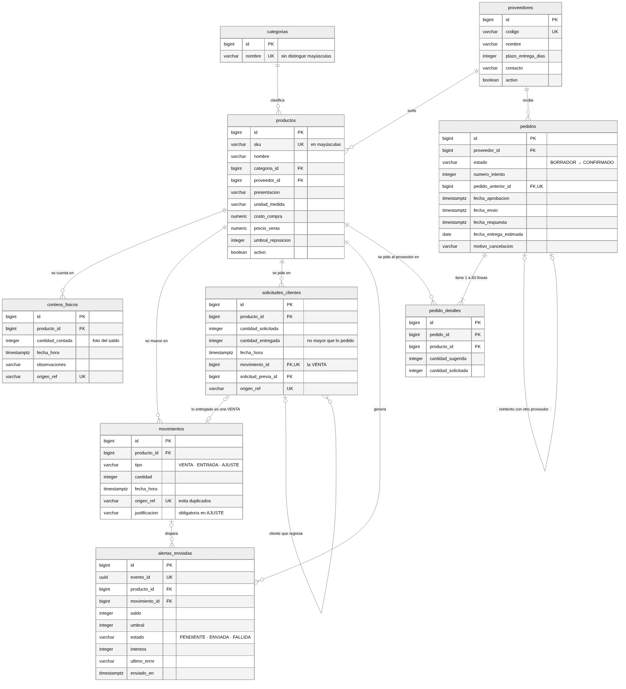
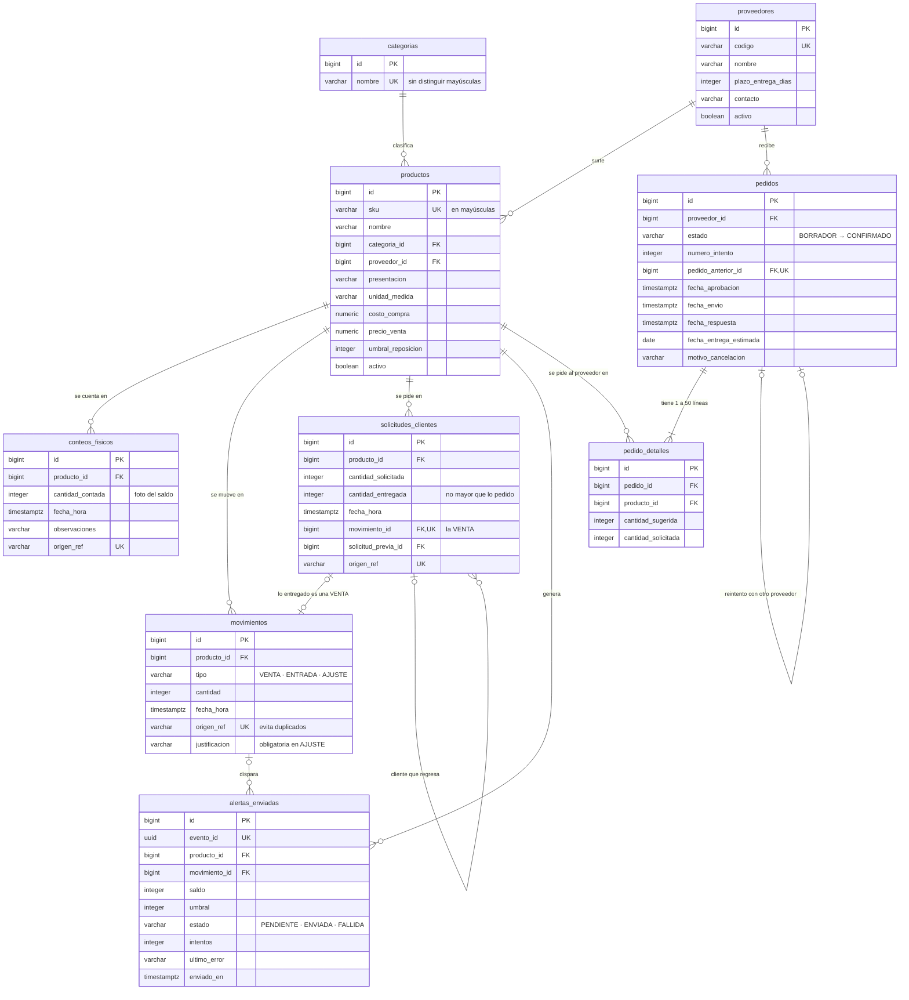
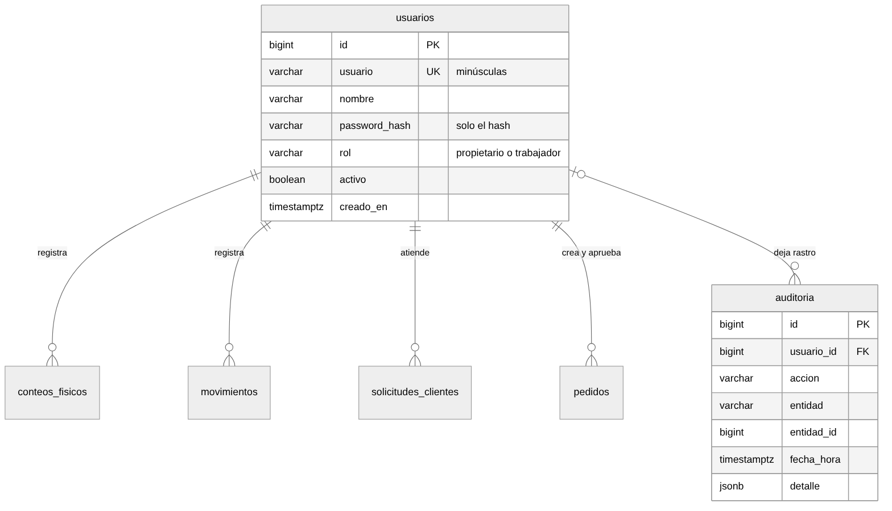
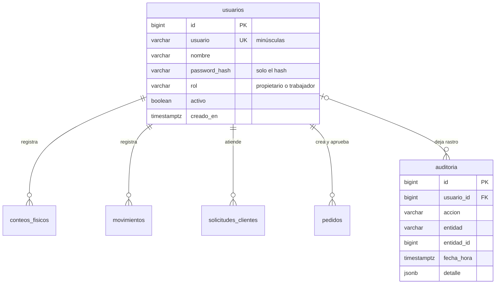

# Modelo de datos · Demanda360

**Fuente de verdad:** [`database/sql/01_schema.sql`](../../database/sql/01_schema.sql). PostgreSQL 16 carga ese archivo al crear la base, y los modelos de SQLAlchemy solo se mapean a sus tablas (no hay `create_all` ni migraciones). Si este diagrama y el esquema no coinciden, manda el esquema.

Son **11 tablas** en dos grupos. El diagrama se divide en dos para que se pueda leer: el núcleo del inventario y los pedidos, y quién registra cada cosa. GitHub dibuja los bloques Mermaid; las imágenes PNG sirven para el documento final.

## 1. Inventario, demanda, alertas y pedidos

## 2. Usuarios y auditoría

Cada registro guarda quién lo hizo. En el diagrama 1 se omiten esas claves (`usuario_id`, `creado_por`, `aprobado_por`) para que no se crucen las líneas.

## 3. Reglas que impone la propia base

Estas reglas se cumplen aunque el backend falle, porque están en el esquema y no en el código:

| Regla | Cómo se impone |
| --- | --- |
| **El saldo no se guarda.** Se calcula como el último conteo más los movimientos posteriores. | No existe una columna de saldo. Lo calculan `fn_saldos()` y `vw_saldos` en `02_vistas.sql`. |
| Un conteo es una foto: reemplaza el saldo, no se suma. | `fn_saldos()` parte del último conteo de cada producto. |
| SKU único y en mayúsculas. | `UNIQUE (sku)` y `CHECK` de mayúsculas. |
| Categoría única sin distinguir mayúsculas. | Índice único sobre `lower(btrim(nombre))`. |
| Cantidades enteras y válidas. | `CHECK` en cada tabla: solicitada > 0, entregada entre 0 y lo solicitado, ajuste distinto de 0. |
| Todo ajuste lleva justificación. | `CHECK` en `movimientos`: el tipo `AJUSTE` exige `justificacion`. |
| Lo entregado es una venta, y lo no entregado no. | `CHECK ((cantidad_entregada > 0) = (movimiento_id IS NOT NULL))` y `UNIQUE (movimiento_id)`. |
| Un formulario reenviado no duplica registros. | `UNIQUE (origen_ref)` en conteos, movimientos y solicitudes. |
| Historial inmutable. | Un trigger bloquea `UPDATE` y `DELETE` en `movimientos`, `conteos_fisicos`, `solicitudes_clientes` y `auditoria`. Una corrección es un ajuste o un conteo nuevo. |
| Un pedido solo se reintenta una vez. | `UNIQUE (pedido_anterior_id)`. |
| Una alerta por evento. | `UNIQUE (evento_id)`; el reintento reutiliza el mismo `evento_id`. |
| Hora de Bogotá en toda la base. | `timestamptz` en todas las fechas y `timezone = America/Bogota`. |

## 4. Datos personales

Ninguna tabla guarda datos de clientes: una atención registra producto y cantidades, no quién compró. Las contraseñas se guardan solo como hash (scrypt). El contacto del proveedor es opcional, y en la demo todos los proveedores son ficticios.

## 5. Vistas para analítica

Los KPI y los sugeridos se calculan una sola vez en `database/sql/02_vistas.sql`. El dashboard de Flask y Power BI (por CSV) leen las mismas vistas, así que no pueden mostrar cifras distintas.

| Vista | Uso |
| --- | --- |
| `vw_saldos`, `vw_estado_productos`, `vw_inventario_actual` | Saldo y estado por producto |
| `vw_ventas_diarias`, `vw_solicitudes` | Demanda: vendidas y no atendidas |
| `vw_sugeridos` | Cantidad sugerida con su fórmula escrita |
| `vw_pedidos` | Pedidos con estados y fechas |
| `vw_kpi_resumen` y `vw_kpi_*` | Los 5 KPI con numerador, denominador y corte |

El diccionario de datos (`docs/requerimientos/diccionario_datos.md`, a cargo del Rol 3) describe cada columna.
