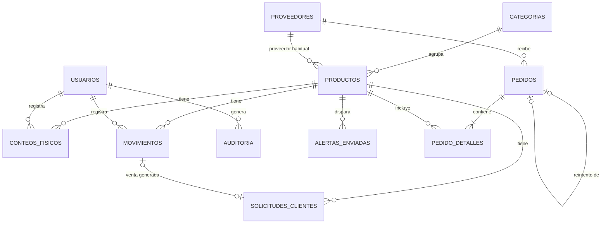

# Demanda360 — Plan del MVP (versión aterrizada)

7 de noviembre de 2026 · Equipo Demanda360

> **Nota del paquete:** el reparto por persona de las secciones 8 y 10 de este plan queda reemplazado por `00_LEEME_PRIMERO.md` (reparto por sistema operativo y experiencia). El resto del plan sigue vigente.

Versión aterrizada del plan: una aplicación Flask con plantillas Jinja sobre PostgreSQL, **una sola automatización en n8n** (venta → stock crítico → correo al propietario) y un tablero en Power BI alimentado por exportaciones de solo lectura. Sin agente de IA, sin servicios en la nube y sin dashboards duplicados: la IA queda como evolución propuesta en E11.

El principio que ordena todo: **Flask valida y registra, PostgreSQL es la única fuente de datos, n8n solo avisa y Power BI solo lee.** Ningún otro componente guarda saldos.

Lo obligatorio (P0) cabe en el domingo; pedidos y aprobación (P1) van el lunes; martes y miércoles son para pruebas, evidencias y documento.

## 1. Viabilidad y alcance

El MVP es viable con cuatro personas si el P0 se limita a lo que aparece abajo y cada integrante trabaja en carpetas distintas. La ruta crítica es el esquema de la base y la transacción de venta (Mac · líder de desarrollo): todo lo demás puede avanzar con datos simulados y mocks mientras tanto.

| Prioridad | Qué incluye | Cuándo |
| --- | --- | --- |
| **P0** | Docker Compose con base, web y n8n · login con dos roles · catálogo con SKU único · conteo inicial · registro de venta (solicitado y entregado) y de entradas · ajustes con justificación · existencias y estado por producto · alerta n8n por correo · auditoría · KPI 1–3 en vistas SQL y en el dashboard de Flask · respaldo y restauración en una base de prueba | Domingo 8 |
| **P1** | Cantidades sugeridas · borrador de pedido · aprobación del propietario · estados del pedido con fechas · KPI 4–5 · Power BI con 5 páginas | Lunes 9 |
| **P2** | IA predictiva, WhatsApp oficial, envío automático de pedidos, servicios en la nube, multiempresa | Solo como propuesta en E11 |

### Qué se recorta del contexto maestro y por qué

- **Chart.js dentro de Flask:** las gráficas van solo en Power BI. Flask muestra tarjetas de KPI y tablas con etiquetas de estado, como el Figma. Evita hacer dos dashboards.
- **Pantalla «Análisis de demanda» en Flask:** pasa a ser una página de Power BI.
- **Movimiento «existencia inicial»:** duplicaba el conteo. La existencia inicial es un conteo físico.
- **Tabla completa de eventos de automatización:** se reduce a `alertas_enviadas`, lo justo para evitar duplicados y reintentar.
- **Ruta separada de solicitudes:** una sola ruta de venta registra cuánto pidió el cliente y cuánto se le entregó. Así la misma venta no se anota dos veces.
- **Conexión de Power BI por red:** se reemplaza por una exportación a CSV de las vistas. No se abre la base a ninguna red.

### Supuestos

1. **Todo el historial es simulado:** 30 días de septiembre de 2026 y las 11 referencias del Figma. Cada exportación lleva la columna `origen_datos = SIMULADO`. Si se levantan datos verificados del negocio, se cargan en otra base (`demanda360_piloto`) y nunca se mezclan.
2. **Registrar entradas es una función del sistema nuevo,** necesaria para mantener el saldo al día. No amplía hacia atrás el proceso diagnosticado.
3. **El umbral de reposición lo define el propietario** para cada producto. En la demo son valores ficticios.
4. **Temporizador BPMN:** su duración queda por validar y no se usan los 2 a 5 días de entrega como tiempo de respuesta. En el sistema, un pedido enviado sin respuesta solo muestra las horas que lleva esperando.
5. **La duplicidad** (pasar la lista al mensaje de WhatsApp) se presenta como potencial hasta validarla con los propietarios.
6. **Las alertas llegan a un correo del equipo,** no a uno de los propietarios.

## 2. Arquitectura

La arquitectura más simple que cumple todo es una sola aplicación Flask, que sirve las pantallas y la API, con PostgreSQL y n8n al lado en Docker Compose. Power BI no se conecta en vivo: lee archivos CSV exportados de las vistas de KPI.


| Componente | Tecnología | Responsabilidad | Lo que NO hace |
| --- | --- | --- | --- |
| Web y API | Flask, Flask-Login, Flask-WTF (CSRF), SQLAlchemy, plantillas Jinja | Validar, registrar, calcular saldo y estado, verificar el rol en cada ruta, escribir auditoría | No envía correos ni guarda copias de saldos |
| Base de datos | PostgreSQL 16 | Fuente oficial; restricciones `UNIQUE`, `CHECK` y claves foráneas; vistas para KPI | No se expone fuera del equipo (puerto atado a 127.0.0.1) |
| Automatización | n8n | Recibir el evento, enviar el correo de prueba, dejar registro de la ejecución | No calcula ni guarda inventario |
| Analítica | Power BI Desktop en Windows | Visualizar los 5 KPI desde CSV | No escribe datos |
| Pantallas | HTML, CSS y JavaScript en plantillas Jinja | Dashboard, Registro y Planificación, basadas en el Figma | No calculan reglas de negocio |

**Por qué el esquema vive en SQL y no en el ORM:** el archivo `01_schema.sql` es la fuente de verdad y PostgreSQL lo carga al iniciar. Los modelos de SQLAlchemy solo se mapean a esas tablas, sin `create_all` ni migraciones. Así Andrés puede escribir vistas y datos de prueba desde el primer momento sin esperar al backend.

**Power BI en otro equipo:** un script corre `\copy` sobre cada vista y deja los CSV en `analytics/datos_demo/`. Andrés los abre en Windows desde el repositorio (son sintéticos). Para actualizar, se vuelve a exportar y se refresca. Además se crea un usuario `lector_bi` de solo lectura, por si más adelante se conecta en vivo dentro del mismo equipo.

## 3. Modelo de datos mínimo

Once tablas: nueve imprescindibles para el P0 y dos para pedidos (P1). Ningún saldo se guarda: se calcula siempre desde el último conteo y los movimientos posteriores, así que no puede haber dos versiones del inventario.



| Tabla | Columnas principales | Restricciones clave | Prioridad |
| --- | --- | --- | --- |
| usuarios | id, nombre, usuario, password\_hash, rol, activo | usuario único; rol propietario o trabajador | P0 |
| categorias | id, nombre | nombre único | P0 |
| proveedores | id, codigo, nombre, plazo\_entrega\_dias, contacto (opcional), activo | código único; plazo > 0 | P0 |
| productos | id, sku, nombre, categoria\_id, proveedor\_id, marca, presentacion, unidad\_medida, costo\_compra, precio\_venta, umbral\_reposicion, activo | SKU único (distingue galón de medio galón); precios ≥ 0; umbral ≥ 0; unidad dentro de una lista | P0 |
| conteos\_fisicos | id, producto\_id, cantidad\_contada, fecha\_hora, usuario\_id, observaciones | cantidad ≥ 0 | P0 |
| movimientos | id, producto\_id, tipo, cantidad, fecha\_hora, usuario\_id, origen\_ref, justificacion | tipo VENTA, ENTRADA o AJUSTE; venta y entrada > 0; ajuste ≠ 0 y con justificación; origen\_ref único | P0 |
| solicitudes\_clientes | id, producto\_id, cantidad\_solicitada, cantidad\_entregada, fecha\_hora, usuario\_id, movimiento\_id | solicitada > 0; 0 ≤ entregada ≤ solicitada | P0 |
| auditoria | id, usuario\_id, accion, entidad, entidad\_id, fecha\_hora, detalle | solo inserción; detalle mínimo en JSON | P0 |
| alertas\_enviadas | id, evento\_id, producto\_id, saldo, umbral, estado, intentos, creado\_en, enviado\_en | evento\_id único; estado PENDIENTE, ENVIADA o FALLIDA | P0 |
| pedidos | id, proveedor\_id, estado, numero\_intento, pedido\_anterior\_id, creado\_por, aprobado\_por, fecha\_creacion, fecha\_aprobacion, fecha\_envio, fecha\_respuesta, fecha\_entrega\_estimada, motivo\_cancelacion | estado BORRADOR, APROBADO, ENVIADO, CONFIRMADO o CANCELADO; intento ≥ 1 | P1 |
| pedido\_detalles | id, pedido\_id, producto\_id, cantidad\_sugerida, cantidad\_solicitada | producto único por pedido; cantidad > 0 | P1 |

Todas las fechas son `timestamptz` (hora de Bogotá). Todas las claves foráneas llevan índice.

### Revisión de normalización del contexto maestro

- **El saldo no se guarda en `productos`:** se calcula en la vista `vw_saldos`. Guardarlo crearía dos verdades.
- **El estado de la solicitud no se guarda:** se deduce de solicitado frente a entregado.
- **Se elimina el movimiento «existencia inicial»:** la existencia inicial es un conteo.
- **Categoría y proveedor habitual pasan a tablas** con clave foránea, para evitar «Laca» y «laca» como valores distintos.
- **El plazo de entrega vive en el proveedor.** Si un mismo proveedor tuviera plazos distintos por producto, se añadiría después una tabla intermedia; el MVP no la necesita.
- **Contactos mínimos:** un campo opcional para el proveedor y ningún dato de clientes.
- **Cliente que regresa:** si vuelve a llevar lo que faltaba, la venta se registra con `solicitud_previa_id` y no se crea otra solicitud. La demanda no se cuenta dos veces.

### Reglas de cálculo

- **Saldo** = último conteo + entradas − ventas ± ajustes posteriores a ese conteo. Sin conteo, el saldo queda vacío («Sin conteo»), nunca en cero.
- **Venta:** se hace en una transacción que bloquea la fila del producto (`SELECT … FOR UPDATE`). Si lo entregado supera el saldo, responde 409 y no se guarda nada, así nunca hay saldos negativos.
- **Estado del producto,** en este orden: Sin conteo → Agotado (saldo 0) → Crítico (saldo ≤ umbral) → Datos insuficientes (menos de 30 días completos desde el primer conteo) → Baja rotación (saldo > 0 y 0 a 2 vendidas en 30 días) → Normal.
- **Cobertura en días** (informativa) = saldo ÷ demanda diaria, con demanda diaria = (vendidas + no atendidas en 30 días) ÷ 30. Se muestra junto al plazo del proveedor.
- **Cantidad sugerida (P1)** = máx(0, techo(demanda diaria × cobertura objetivo − saldo)), con 14 días de cobertura por defecto, igual que el Figma. Con datos insuficientes la cantidad es manual.
- **Alerta:** solo cuando una venta hace cruzar el umbral (saldo antes > umbral y saldo después ≤ umbral). Ventas posteriores bajo el umbral no repiten la alerta.

## 4. Contrato de API

Quince rutas, diez de ellas P0. El frontend trabaja desde el primer minuto con archivos mock que tienen exactamente estas respuestas; cuando el backend esté listo, solo se cambia una variable.

### Convenciones

- Base `/api`, JSON en UTF-8, fechas ISO 8601 con zona (`-05:00`).
- **Sesión:** el login es un formulario en `/login` (Flask-Login). Una ruta `/api` sin sesión responde 401.
- **CSRF:** todo `POST` envía la cabecera `X-CSRFToken`; el token está en un `<meta>` de `base.html`.
- **Rol:** se verifica en el backend en cada ruta. Ocultar un botón no cuenta como control.
- **Sin duplicados:** el formulario genera un `origen_ref` (UUID) al abrirse. Si se reenvía, la API devuelve 200 con el registro existente en vez de crear otro.
- **Mocks:** `frontend/static/mock/*.json`, activados con `USE_MOCK = true` en `api.js`.
- **Errores:** siempre el mismo formato. Un 500 nunca muestra trazas, consultas ni credenciales.

| Código | Cuándo |
| --- | --- |
| 200 / 201 | Consulta correcta / registro creado |
| 400 `VALIDACION` | Falta un campo, cantidad no entera, negativa o fuera de rango |
| 401 `NO_AUTENTICADO` | Sin sesión |
| 403 `SIN_PERMISO` | El rol no puede hacer esa acción |
| 404 `NO_ENCONTRADO` | El producto o pedido no existe |
| 409 `SKU_DUPLICADO`, `STOCK_INSUFICIENTE`, `TRANSICION_INVALIDA` | Choca con una regla de negocio |
| 500 `ERROR_INTERNO` | Mensaje genérico; el detalle va solo al log |

### Rutas

| Método y ruta | Rol | Qué hace | Prioridad |
| --- | --- | --- | --- |
| `GET /api/health` | Público | Estado de la app y de la base | P0 |
| `GET /api/productos` | Ambos | Lista con saldo y estado | P0 |
| `POST /api/productos` | Propietario | Crea un producto | P0 |
| `GET /api/productos/{id}` | Ambos | Detalle y últimos 10 movimientos | P0 |
| `POST /api/conteos` | Ambos | Registra un conteo físico | P0 |
| `POST /api/ventas` | Ambos | Atención: solicitado y entregado; genera la venta y, si cruza el umbral, la alerta | P0 |
| `POST /api/movimientos` | Entrada: ambos · Ajuste: propietario | Entrada de mercancía o ajuste con justificación | P0 |
| `GET /api/dashboard` | Ambos | KPI y productos críticos | P0 |
| `GET /api/analisis/rotacion` | Ambos | Estado, vendidas en 30 días y cobertura por producto | P0 |
| `GET /api/auditoria` | Propietario | Últimas operaciones registradas | P0 |
| `GET /api/sugeridos?cobertura=14` | Propietario | Cantidades sugeridas con su explicación | P1 |
| `GET /api/pedidos` | Ambos | Lista de pedidos | P1 |
| `POST /api/pedidos` | Ambos | Crea un borrador | P1 |
| `POST /api/pedidos/{id}/aprobar` | Propietario | Borrador → aprobado | P1 |
| `POST /api/pedidos/{id}/estado` | Propietario | Aprobado → enviado → confirmado o cancelado (con reintento a otro proveedor) | P1 |

La ruta `POST /api/solicitudes` del contexto maestro se fusiona con `POST /api/ventas`: una atención al cliente es un solo registro.

### Ejemplos

**Crear producto** — `POST /api/productos` (valores ficticios)

```json
{
  "sku": "LAC-BP-01",
  "nombre": "Laca catalizada alto brillo galón",
  "categoria_id": 1,
  "proveedor_id": 1,
  "marca": "ColorNova (ficticia)",
  "presentacion": "Galón",
  "unidad_medida": "galon",
  "costo_compra": 85000,
  "precio_venta": 110000,
  "umbral_reposicion": 5
}
```

Respuesta `201` con el producto creado (`id`, `activo: true`, `creado_en`). Con un SKU repetido:

```json
{
  "error": {
    "codigo": "SKU_DUPLICADO",
    "mensaje": "Ya existe un producto con el SKU LAC-BP-01.",
    "campos": { "sku": "duplicado" }
  }
}
```

**Registrar una atención** — `POST /api/ventas`

```json
{
  "producto_id": 3,
  "cantidad_solicitada": 3,
  "cantidad_entregada": 2,
  "origen_ref": "9f1c2e7a-4b5d-4c1e-9a77-1d2f3e4a5b6c",
  "solicitud_previa_id": null
}
```

Respuesta `201`. Si el correo falla, `alerta.estado` llega como `FALLIDA`, pero la venta ya quedó guardada:

```json
{
  "solicitud_id": 140,
  "movimiento_id": 512,
  "no_atendida": 1,
  "producto": {
    "id": 3,
    "sku": "ESM-WH-01",
    "saldo_anterior": 4,
    "saldo_actual": 2,
    "umbral_reposicion": 3,
    "estado": "CRITICO"
  },
  "alerta": { "evento_id": "5b0e8c1d-7f2a-4e3b-9c6d-0a1b2c3d4e5f", "estado": "ENVIADA" }
}
```

Si se intenta entregar más de lo disponible: `409 STOCK_INSUFICIENTE`, con el mensaje «Saldo disponible: 2. No se puede entregar 3.»

**Dashboard** — `GET /api/dashboard` (datos simulados, cifras del Figma)

```json
{
  "corte": "2026-09-30",
  "origen_datos": "SIMULADO",
  "kpis": [
    { "codigo": "KPI1", "nombre": "Referencias agotadas", "valor": 27.3, "unidad": "%", "numerador": 3, "denominador": 11 },
    { "codigo": "KPI2", "nombre": "Demanda no atendida", "valor": 8.6, "unidad": "%", "numerador": 12, "denominador": 139 },
    { "codigo": "KPI3", "nombre": "Baja rotación", "valor": 50.0, "unidad": "%", "numerador": 5, "denominador": 10, "nota": "1 referencia con datos insuficientes" }
  ],
  "criticos": [
    { "id": 1, "sku": "LAC-BP-01", "nombre": "Laca catalizada alto brillo galón", "saldo": 0, "estado": "AGOTADO", "plazo_entrega_dias": 3 }
  ]
}
```

**Rotación** — `GET /api/analisis/rotacion` (fragmento)

```json
{
  "corte": "2026-09-30",
  "origen_datos": "SIMULADO",
  "productos": [
    { "sku": "LAC-NG-01", "nombre": "Laca nogal galón", "saldo": 9, "vendidas_30d": 1, "no_atendidas_30d": 0, "cobertura_dias": 270, "plazo_entrega_dias": 4, "estado": "BAJA_ROTACION" },
    { "sku": "LAC-TR-01", "nombre": "Laca transparente galón", "saldo": 8, "dias_con_registro": 3, "estado": "DATOS_INSUFICIENTES" }
  ]
}
```

**Sugerido (P1)** — cada línea trae su explicación:

```json
{ "sku": "LAC-BP-01", "demanda_diaria": 1.7, "cobertura_dias": 14, "saldo": 0, "sugerido": 24, "formula": "techo(1,70 × 14 − 0) = 24", "regla_version": 1 }
```

**Permiso negado** — un trabajador intenta `POST /api/pedidos/7/aprobar`:

```json
{ "error": { "codigo": "SIN_PERMISO", "mensaje": "Solo un propietario puede aprobar pedidos." } }
```

## 5. Automatización en n8n

Un solo flujo: **venta registrada → saldo cruza el umbral → correo al propietario.** La venta se guarda primero; si el correo falla, la venta no se pierde y la alerta se puede reintentar.

1. El trabajador registra la atención en Flask.
2. Flask valida y, en una sola transacción, guarda la solicitud, la venta, la auditoría y, si el saldo cruzó el umbral, una fila en `alertas_enviadas` con un `evento_id` único y estado `PENDIENTE`.
3. Tras confirmar la transacción, Flask envía el evento al webhook de n8n con la cabecera de token y un tiempo máximo de 3 segundos.
4. n8n comprueba el token, arma el correo y lo envía.
5. n8n responde 200 y Flask marca la alerta como `ENVIADA`. Si no hay respuesta, la marca `FALLIDA` y suma un intento.
6. El comando `flask reintentar-alertas` reenvía las fallidas (máximo 3 intentos) con el mismo `evento_id`.

**Evento que recibe n8n**, con la cabecera `X-Demanda360-Token` igual a `N8N_WEBHOOK_TOKEN` del `.env`:

```json
{
  "evento_id": "5b0e8c1d-7f2a-4e3b-9c6d-0a1b2c3d4e5f",
  "tipo": "STOCK_CRITICO",
  "ocurrido_en": "2026-11-08T15:42:10-05:00",
  "origen_datos": "SIMULADO",
  "producto": { "sku": "ESM-WH-01", "nombre": "Esmalte blanco galón", "saldo": 2, "umbral": 3, "plazo_entrega_dias": 3 }
}
```

**Nodos del flujo:** Webhook (POST, autenticación por cabecera) → Send Email (SMTP) → Respond to Webhook. Si la versión de n8n lo trae, un nodo Remove Duplicates por `evento_id` como segunda barrera.

**Reglas:**

- **Sin duplicados:** solo se crea alerta cuando el saldo cruza el umbral, y cada alerta tiene un `evento_id` único en la base.
- **Sin datos personales:** el correo lleva SKU, nombre, saldo, umbral y plazo; nada de clientes ni de contactos.
- **n8n no se expone:** Flask le habla por la red interna de Docker (`http://n8n:5678`) y el panel solo abre en `localhost`.
- **Correo de prueba:** una cuenta del equipo con contraseña de aplicación, o una bandeja de pruebas como Mailtrap.
- **El flujo se exporta** a `automation/workflows/alerta_stock_critico.json` sin credenciales.

**Evidencia:** captura de la ejecución en n8n, el correo recibido y la fila `ENVIADA`. Además, una prueba con n8n apagado: la venta queda guardada, la alerta queda `FALLIDA`, se enciende n8n, se corre el reintento y pasa a `ENVIADA`.

**Opcional, solo si sobra tiempo:** un resumen diario a las 7:00 en el que n8n lee la vista de productos críticos con el usuario de solo lectura y envía un correo.

## 6. KPI y Power BI

Los cinco KPI se calculan una sola vez, en vistas SQL. El dashboard de Flask y Power BI leen esas mismas vistas, así que no pueden mostrar cifras distintas. Todos son mensuales con corte explícito, su responsable son los propietarios y su valor inicial queda pendiente hasta tener datos reales.

| KPI | Fórmula | Vista | Regla de calidad del dato | Meta preliminar |
| --- | --- | --- | --- | --- |
| 1. Referencias agotadas (%) | Referencias con saldo verificado 0 / referencias con conteo al corte × 100 | `vw_kpi_agotadas` | Sin conteo no es cero: queda fuera del denominador | −20 % relativo frente a la línea base |
| 2. Demanda no atendida (%) | Σ (solicitado − entregado) / Σ solicitado × 100 | `vw_kpi_demanda` | Una solicitud por atención; el cliente que regresa no suma demanda | −20 % relativo |
| 3. Baja rotación (%) | Referencias con saldo > 0 y 0–2 vendidas en 30 días / referencias con 30 días completos y conteo × 100 | `vw_kpi_rotacion` | Menos de 30 días = «Datos insuficientes», fuera del denominador; regla a validar por familia | −10 % relativo |
| 4. Tiempo de confirmación del proveedor (horas) | Promedio de (respuesta − envío) de los pedidos con ambas fechas en el período | `vw_kpi_respuesta` | Los pedidos sin respuesta no se promedian, se cuentan aparte; no confundir con el plazo de entrega de 2 a 5 días | Sin meta hasta tener línea base |
| 5. Confirmados con el primer proveedor (%) | Pedidos confirmados en el intento 1 / pedidos confirmados en el período, contando cada cadena de reintentos una vez × 100 | `vw_kpi_primer_proveedor` | Cada reintento enlaza `pedido_anterior_id`; un pedido cancelado sin reintento no entra | Sin meta hasta tener línea base |

En los KPI 1 a 4, un valor más bajo es mejor; en el 5, uno más alto. Las fichas completas, con los diez campos que pide el contexto maestro, van en `docs/requerimientos/kpi.md`. Ninguna meta se presenta como logro.

### Datos de demostración

Un script con semilla fija (`database/seeds/generar_demo.py`) genera 30 días de septiembre para las 11 referencias del Figma, con los mismos totales: 127 unidades vendidas, 12 no atendidas y el conteo del 30 de septiembre. También crea algunos pedidos con fechas para alimentar los KPI 4 y 5. Con esos datos, los KPI 1 a 3 deben dar 27 %, 8,6 % y 50 %, y una prueba automática lo verifica.

### Power BI

`analytics/exportar_csv.sh` exporta cinco vistas (`vw_inventario_actual`, `vw_ventas_diarias`, `vw_solicitudes`, `vw_kpi_resumen`, `vw_pedidos`) a CSV, cada una con la columna `origen_datos`. El tablero tiene cinco páginas, todas con la marca «Datos simulados»:

1. **Resumen:** las cinco tarjetas de KPI con numerador, denominador y período.
2. **Disponibilidad:** estado por producto, agotados, críticos y cobertura frente al plazo del proveedor.
3. **Demanda:** vendidas frente a no atendidas por referencia y tendencia diaria.
4. **Baja rotación:** referencias clasificadas y las que tienen datos insuficientes.
5. **Pedidos y proveedores:** estados, horas de confirmación y confirmados con el primer proveedor.

Andrés deja una hoja de verificación que recalcula a mano cada KPI desde los CSV. Si no cuadra con la vista, se corrige la vista, no el tablero.

## 7. Seguridad, continuidad y ética

Los doce controles mínimos se implementan en el código y cada uno deja una evidencia que se puede mostrar. Prueban la capacidad del MVP en el entorno de demostración; no significan que Pinturas By-plus tenga un SGSI ni una certificación.

| # | Control | Cómo se implementa | ISO/IEC 27002 | Evidencia |
| --- | --- | --- | --- | --- |
| 1 | SKU único | `UNIQUE` en la base y validación en Flask | 8.26 | Prueba: SKU repetido devuelve 409 |
| 2 | Cantidades y unidades | Enteros, ≥ 0, unidad dentro de la lista; `CHECK` en la base | 8.26 | Prueba: cantidad inválida devuelve 400 |
| 3 | Autenticación | Flask-Login, sesión con vencimiento, cookie `HttpOnly` | 8.5 | Prueba: ruta sin sesión devuelve 401 |
| 4 | Contraseñas con hash | `generate_password_hash` de Werkzeug | 5.17 | Consulta a `usuarios` que muestra solo hashes |
| 5 | Permisos por rol | Decorador `@requiere_rol` en cada ruta del backend | 5.15 | Prueba: el trabajador recibe 403 |
| 6 | Aprobación del propietario | Solo un propietario pasa un pedido a aprobado; solo se envía lo aprobado | 5.15 | Prueba: transición inválida devuelve 409 |
| 7 | Bitácora | Fila en `auditoria` dentro de la misma transacción | 8.15 | `GET /api/auditoria` |
| 8 | Ajustes justificados | Solo propietario, justificación obligatoria, nunca se borra un movimiento | 8.15 | Prueba: ajuste sin justificación devuelve 400 |
| 9 | Credenciales en variables de entorno | `.env` fuera de Git, `.env.example` sin valores | 5.17 | `.gitignore` y revisión del historial |
| 10 | Respaldo y restauración | Scripts de `pg_dump` y restauración en una base de prueba | 8.13 | Registro de respaldos con duración medida |
| 11 | Minimización de datos personales | Sin datos de clientes; contacto de proveedor opcional; demo ficticia | 5.34 | Diccionario de datos |
| 12 | Control de versiones | `main` protegida, cambios solo por pull request | 8.32 | Historial de PR |

Además: el puerto de PostgreSQL atado a `127.0.0.1`, CSRF en todos los formularios, `DEBUG` apagado en la demo y errores sin trazas.

### Respaldo, restauración y contingencia

Un volumen de Docker conserva los datos si se reinicia el contenedor, pero no es un respaldo: si se borra o se corrompe, se pierde con todo.

1. `scripts/backup.sh` corre `pg_dump` y guarda `demanda360_AAAAMMDD_HHMM.dump` en una carpeta **fuera del repositorio**.
2. `scripts/restore_prueba.sh` crea la base `demanda360_restore`, restaura la copia, compara conteos de tablas y el saldo de tres referencias con la base original, y mide cuánto tardó.
3. Cada ejecución se anota en `docs/seguridad/registro_respaldos.md`: fecha del respaldo, resultado, fecha de la restauración, duración y registros verificados.
4. **RPO de 1 hora:** se documenta la línea de `cron` horaria; en la demo el respaldo se corre a mano. **RTO de 4 horas:** se compara con el tiempo medido para restaurar, levantar la web y verificar. Ambos siguen siendo objetivos; solo se reporta lo medido en el entorno de prueba.
5. **Contingencia:** una plantilla de folios manuales numerados. Al volver el sistema, cada folio se carga con su número como `origen_ref`, así que no se duplica.

### Correcciones a la matriz de riesgos (retroalimentación del 80/100)

1. Mostrar la matriz completa: riesgo **inherente** (antes del tratamiento) y **residual** (después), cada puntaje con su justificación escrita.
2. Añadir una tabla de criterios cualitativos para P1–P3 e I1–I3. Las probabilidades son juicios con criterio declarado, no estadísticas.
3. Separar **base de datos** como activo propio con impacto I3: sin historial no hay KPI ni sugerencias, y la reconstrucción depende de folios y facturas. Su residual solo baja si la restauración de prueba sale bien.
4. Añadir la columna de evidencia, tomada de la tabla de controles.

### Ética

- **Reglas transparentes:** cada sugerencia muestra su fórmula y sus datos; nada de cajas negras.
- **Demanda subestimada:** se registra la demanda no atendida, así un producto agotado no aparece como «sin demanda».
- **Datos insuficientes:** se muestran como tales, nunca como cero ni como mal desempeño.
- **Proveedores pequeños:** el MVP no puntúa proveedores. El KPI 5 mide el proceso, no califica a nadie.
- **Responsabilidad:** el propietario aprueba cada pedido y queda registrado quién lo hizo.
- **Privacidad:** datos mínimos, de acuerdo con la Ley 1581 de 2012. Ninguna conversación de clientes o proveedores entra al sistema.
- **IA como evolución:** solo tendría sentido con varios meses de registros reales, recomendaciones explicables y revisión humana.

## 8. Repositorio, ramas y archivos por integrante

Se usa la estructura del contexto maestro con cuatro ajustes, y cada carpeta tiene un solo dueño. Los ajustes: se quita `templates_config/` (la configuración va en `app/config.py`); se quita `database/backups_ejemplo/` (los respaldos nunca entran al repositorio); las evidencias de n8n van a `docs/evidencias/`; y se agregan `scripts/` y `docs/api/`.

```text
demanda360/
├── compose.yaml  .env.example  .gitignore  README.md
├── backend/
│   ├── Dockerfile  requirements.txt  run.py  cli.py
│   ├── app/
│   │   ├── __init__.py  config.py  extensions.py  security.py
│   │   ├── models/      tablas mapeadas (sin create_all)
│   │   ├── routes/      auth, productos, inventario, dashboard, pedidos, vistas
│   │   └── services/    inventario, alertas, pedidos, auditoria
│   └── tests/
├── frontend/
│   ├── templates/       base, login, dashboard, registro, planificacion
│   └── static/          css/  js/ (api.js + uno por pantalla)  mock/*.json
├── database/
│   ├── sql/             01_schema.sql  02_vistas.sql  03_roles.sql
│   └── seeds/           generar_demo.py  10_demo.sql
├── analytics/           exportar_csv.sh  datos_demo/  consultas/  powerbi/
├── automation/          workflows/alerta_stock_critico.json  README.md
├── scripts/             backup.sh  restore_prueba.sh
└── docs/                api/  arquitectura/  bpmn/  requerimientos/  seguridad/  evidencias/
```

| Integrante | Rama | Es dueño de | Documenta |
| --- | --- | --- | --- |
| Brayan | `feature/backend` | `compose.yaml`, `.env.example`, `backend/` (salvo las pruebas de seguridad), `database/sql/01_schema.sql`, `docs/api/contrato.md`; integra `main` | Requerimientos (E6) y arquitectura (E10) |
| Olmer | `feature/frontend` | `frontend/` completo: plantillas, CSS, JS y mocks | BPMN AS-IS corregido y TO-BE (E3, E5) |
| Andrés Sebastián | `feature/analytics` | `database/sql/02_vistas.sql`, `database/seeds/`, `analytics/` | Diccionario de datos, fichas de KPI y dashboard (E7, E8, E9) |
| Jhonatan | `feature/automation` | `automation/`, `scripts/`, `database/sql/03_roles.sql`, `backend/tests/test_seguridad.py`, `backend/tests/test_integracion.py`, `docs/seguridad/`, `docs/evidencias/` | Matriz de riesgos, continuidad y ética; automatización (E11) |

**Archivos compartidos con reglas:**

- Un cambio en `docs/api/contrato.md` necesita la aprobación de Brayan y de Olmer.
- `backend/app/routes/vistas.py` (las rutas que muestran las plantillas) es de Brayan; Olmer pide ahí lo que necesite.
- En `README.md` cada quien edita solo la sección de su carpeta.
- `CODEOWNERS` asigna cada carpeta a su dueño, que revisa sus PR.

### Rutina de Git de cada integrante

```bash
git switch main && git pull           # traer lo último de main
git switch feature/frontend           # tu rama
git merge main                        # ponerla al día
# ... trabajar y probar ...
git add -A
git commit -m "feat(frontend): formulario de registro"
git push                              # luego abrir un PR hacia main en GitHub
```

- `main` está protegida: solo entra por PR con una aprobación y las pruebas en verde.
- Cada integrante abre al menos dos PR al día, pequeños, para no acumular conflictos.
- Nunca se suben `.env`, contraseñas, respaldos, bases reales, datos bancarios ni capturas sin censurar.

## 9. Criterios de aceptación por módulo

Un módulo está terminado cuando cumple todos sus criterios con los datos simulados. Las casillas sirven para ir marcando el avance.

**Infraestructura y base (Mac · líder de desarrollo)**

- [ ] `docker compose up -d` levanta base, web y n8n sin errores en un Ubuntu limpio.
- [ ] `GET /api/health` responde `{"estado": "ok", "bd": "ok"}`.
- [ ] PostgreSQL no responde desde otro equipo de la red.

**Backend (Mac · líder de desarrollo)**

- [ ] Producto válido → 201; SKU repetido → 409; cantidad inválida → 400.
- [ ] Con un conteo de 5 y una venta de 2, el saldo queda en 3.
- [ ] Una venta mayor que el saldo responde 409 y no guarda nada.
- [ ] Un trabajador no puede ajustar ni aprobar: 403.
- [ ] Cada operación deja una fila en `auditoria`.
- [ ] `pytest` en verde.

**Frontend (Windows B · pantallas)**

- [ ] Dashboard, Registro y Planificación funcionan con mocks y luego con la API real, cambiando solo `USE_MOCK`.
- [ ] Los formularios muestran el mensaje de error de la API (400 o 409) sin perder lo escrito.
- [ ] La etiqueta «Datos simulados» se ve en todas las pantallas.
- [ ] Los botones de propietario no se muestran al trabajador (y el backend igual responde 403).

**Analítica (Windows A · datos)**

- [ ] Con los datos simulados: KPI 1 = 27 %, KPI 2 = 8,6 %, KPI 3 = 50 %, sugerido de la laca alto brillo = 24 y total = 54.
- [ ] Las cinco vistas se exportan a CSV con `origen_datos`.
- [ ] Power BI muestra los cinco KPI en cinco páginas y la hoja de verificación cuadra.

**Automatización y seguridad (Ubuntu · infra y seguridad)**

- [ ] Una venta que cruza el umbral produce un correo recibido y una fila `ENVIADA`.
- [ ] Una segunda venta bajo el umbral no repite el correo.
- [ ] Con n8n apagado, la venta se guarda y la alerta queda `FALLIDA`; el reintento la pasa a `ENVIADA`.
- [ ] El webhook rechaza una llamada sin token.
- [ ] Respaldo restaurado en `demanda360_restore`, con duración y conteos anotados.
- [ ] Matriz de riesgos completa, con inherente, residual y criterios.

**Integración (todos, martes)**

- [ ] El guion de la demo recorre en orden los 13 criterios de la sección 20 del contexto maestro: crear producto, rechazar SKU repetido, rechazar cantidad inválida, conteo, venta, saldo correcto, cambio no autorizado bloqueado, alerta, movimiento visible en los datos, KPI calculado, respaldo, restauración y consulta de auditoría.

## 10. Plan intensivo hasta el 11 de noviembre

El P0 queda integrado el domingo a las 20:00, el P1 se congela el lunes a las 20:00 y el martes solo se prueba, se documenta y se graba. Si un control falla, se recorta alcance; la fecha no se mueve.

| Bloque | Brayan | Olmer | Andrés Sebastián | Jhonatan |
| --- | --- | --- | --- | --- |
| **Sáb 7, noche** | Repositorio con el esqueleto, `compose.yaml`, `01_schema.sql` | Clonar; preparar `base.html` con el estilo del Figma | Clonar; revisar el esquema | Clonar; levantar n8n; crear el correo de prueba |
| **Dom 8, 8:00–13:00** | Modelos, `/api/health`, productos y conteos | Login, Dashboard y Registro con mocks | `generar_demo.py` y vistas de KPI 1–3 | Webhook y correo probados con `curl`; `backup.sh` |
| **Control 1, 13:00** | Esquema y datos demo cargan con `docker compose up` | Pantallas visibles con mocks | Vistas devuelven 27 %, 8,6 % y 50 % | Llega un correo enviado con `curl` |
| **Dom 8, 14:00–19:00** | Venta en transacción, saldo, alerta, movimientos, auditoría, roles | Formularios conectados a la API real | `exportar_csv.sh` y página Resumen de Power BI | `restore_prueba.sh` y `test_seguridad.py` |
| **Control 2, 20:00 (P0)** | Una venta desde el formulario cambia el saldo, dispara el correo y aparece en el CSV | ← | ← | ← |
| **Lun 9, mañana** | Sugeridos, pedidos, aprobación y estados (P1) | Pantalla Planificación | KPI 4–5 y las otras páginas de Power BI | `test_integracion.py`, reintento de alertas, matriz corregida |
| **Lun 9, tarde** | Requerimientos (E6), contrato final | BPMN AS-IS corregido y TO-BE | Diccionario de datos y fichas de KPI | Simulacro de restauración; continuidad y ética |
| **Control 3, 20:00** | Congelamiento: lo que no funcione pasa a «propuesto» | ← | ← | ← |
| **Mar 10** | Pruebas extremo a extremo; README final y etiqueta `v1.0` | Presentación ejecutiva | Consolidar el documento final | Video de respaldo de la demo y carpeta de evidencias |
| **Mié 11** | Ensayo y entrega temprana por Canvas | ← | ← | ← |

**Preguntas para los propietarios, a enviar esta noche:** qué dispara hoy la revisión (día fijo o cuando algo se agota); cuánto tarda más o menos cada etapa; cuánto esperan una respuesta del proveedor antes de llamar a otro; si la lista se escribe primero y después se pasa a WhatsApp; y, si quieren colaborar, 10 a 15 referencias con su existencia, costo, precio, proveedor y un umbral propuesto. Lo que respondan entra como dato del negocio; lo que no, queda como supuesto declarado.

## 11. Dependencias, riesgos y plan B

La dependencia que más pesa es el esquema y el contrato de la API: por eso salen esta noche con el esqueleto y los demás carriles trabajan con mocks y datos demo mientras el backend avanza.

| Riesgo o dependencia | Prob. | Impacto | Mitigación | Plan B |
| --- | --- | --- | --- | --- |
| Todo depende del esquema y del contrato | Alta | Alto | Se entregan esta noche; cualquier cambio va por PR con dos aprobaciones | Mocks y datos demo dejan avanzar aunque el backend se atrase |
| La transacción de venta con alerta se complica (ruta crítica) | Media | Alto | Lógica en un servicio con pruebas; la alerta sale después de confirmar la venta | La venta funciona primero; la alerta se demuestra con el reintento |
| El correo no sale (SMTP bloqueado) | Media | Medio | Contraseña de aplicación o Mailtrap, probado el sábado | Evidencia con la ejecución de n8n y la fila de alerta |
| Power BI no logra leer los datos | Baja | Medio | CSV dentro del repositorio | Las tarjetas de KPI del dashboard de Flask |
| Docker falla en algún portátil | Media | Medio | Ubuntu como entorno principal, probado esta noche | Ese integrante trabaja en lo que no necesita Docker (mocks, SQL, documentos) y prueba en otro equipo |
| Flask-Login y CSRF son nuevos para el equipo | Media | Medio | Vienen listos en el esqueleto | — |
| Conflictos de Git | Media | Medio | Un dueño por carpeta, `CODEOWNERS`, PR pequeños | Brayan resuelve al integrar |
| Crece el alcance | Alta | Alto | Congelamiento el lunes a las 20:00 | Lo pendiente del P1 pasa a propuesta |
| Datos demo incoherentes | Media | Alto | Generador con semilla fija y una prueba que exige las cifras del Figma | — |
| Se sube una clave o un dato sensible | Media | Alto | `.gitignore` desde el primer commit; revisar el diff antes de cada PR | Revocar la clave y limpiar el historial |
| Un integrante no está disponible | Media | Medio | Respaldos cruzados: Brayan con Jhonatan, Olmer con Andrés | — |

### Limitaciones que se declaran en la sustentación

- No hay línea base real: los KPI muestran cómo se mediría, no una mejora comprobada.
- El RTO y el RPO solo se miden en el entorno de demostración.
- Las sugerencias son reglas; no hay pronóstico ni IA en el MVP.
- El sistema se propone como piloto: Pinturas By-plus no lo está usando.

## 12. Cómo se refleja cada entregable

Los 17 puntos que pidió el profesor quedan cubiertos, y cada uno dice si está implementado, demostrado con simulación, documentado o propuesto.

| # | Entregable | Cómo aparece | Tipo | Responsable |
| --- | --- | --- | --- | --- |
| 1 | Caracterización de By-plus | E1 ya entregado | Documento | Todos |
| 2 | Problema empresarial | E1, con el impacto estimado por los propietarios que pidió el profesor | Documento | Todos |
| 3 | BPMN AS-IS | Corregido: fricciones E, T y D, temporizador con duración por validar, «respuesta del proveedor» como entrada | Modelo | Olmer |
| 4 | Fricciones MEDITA | M, I, E, T y D (esta última como potencial) | Documento | Olmer |
| 5 | BPMN TO-BE | Registro digital, alerta, sugerido, aprobación y estados del pedido, con la tabla fricción → cambio → efecto | Modelo | Olmer |
| 6 | Requerimientos | Derivados del TO-BE; cada RF con su ruta y su prueba | Documento | Brayan |
| 7 | Modelo de datos | Diagrama entidad-relación y `01_schema.sql` | Implementado | Brayan y Andrés |
| 8 | KPI | Cinco fichas y sus vistas SQL | Implementado con datos simulados | Andrés |
| 9 | Dashboard | Figma como diseño, tarjetas en Flask y Power BI | Simulación | Andrés y Olmer |
| 10 | Arquitectura | Este documento y `compose.yaml` funcionando | Implementado | Brayan |
| 11 | Automatización, analítica e IA | Alerta n8n implementada; IA como propuesta con condiciones | Implementado + propuesta | Jhonatan |
| 12 | Matriz de riesgos | Completa, con inherente, residual y criterios | Documento | Jhonatan |
| 13 | ISO 27001 y 27002 | Doce controles con evidencia; sin afirmar certificación | Implementado | Jhonatan |
| 14 | Continuidad | Respaldo y restauración medidos; folios de contingencia | Implementado (medido en demo) | Jhonatan |
| 15 | Ética y datos | Reglas transparentes, datos mínimos, aprobación humana | Documento | Jhonatan |
| 16 | Evidencias | `docs/evidencias/` con capturas, pruebas y actas | Implementado | Todos |
| 17 | Conclusiones y siguientes pasos | Lo logrado, lo medido y lo que se propone para un piloto real | Documento | Todos |

## Siguiente paso

Con este plan aprobado, se genera el esqueleto del repositorio: `compose.yaml`, `Dockerfile`, `.env.example`, `.gitignore`, `CODEOWNERS`, `01_schema.sql`, la app Flask con login, roles y `/api/health`, los mocks del frontend y `docs/api/contrato.md`. También un prompt de trabajo para cada integrante y los comandos de Linux, Docker, PostgreSQL, Flask y Git explicados paso a paso.

- [ ] Aprobar este plan.
- [ ] Definir quién crea el repositorio privado en GitHub e invita a los demás.
- [ ] Elegir el correo de prueba: Gmail del equipo con contraseña de aplicación, o Mailtrap.
